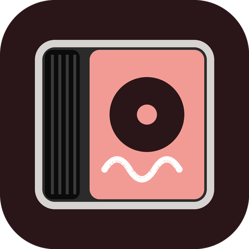

<p align="center">
  
</p>

# Transient

A modern Android music player for people who care how it sounds: **bit-perfect USB DAC output**, a live **DAC signal-path** view, and a player built around the CD jewel case.

Transient is in **alpha**. It is used every day, but expect rough edges. It is built on [Lune](https://github.com/MrDemonc/Lune) and [decent-player](https://github.com/Ma145/decent-player); see [Credits & licence](#credits--licence).

## Features

**Sound**

- **USB bit-perfect output** to USB Audio Class 2.0 DACs: no Android mixer, no resampling, automatic sample-rate switching (44.1 kHz – 384 kHz). Needs Android 10+.
- **DAC signal path** screen: source → decoder → processing → USB driver → DAC, with a bit-perfect verdict.
- Plug the DAC in during a song and playback moves to it.
- The phone's volume keys set the DAC level in software (the top step is left untouched), and the level stays steady when other apps change Android's audio route.
- On the normal output (speaker, Bluetooth, wired): equalizer, bass boost, reverb, spatial audio, crossfade, speed and pitch, sleep timer.
- Formats: FLAC (libFLAC), and WAV, AIFF, ALAC (`.m4a`), AAC, MP3, Ogg/Opus and more through FFmpeg. DSD is not supported yet.

**Player and library**

- A **jewel-case player**: the cover sits in a CD case with a black ribbed spine, a reflection, and a disc that slides in and out.
- Colours and the app logo follow the album art that is playing.
- Fast library scanning with a cache, tuned for large lossless libraries. Albums, artists, genres, folders, playlists (import, export, backup) and tag editing.
- Synced lyrics with an editor, a queue with "Add to queue", home-screen widget, headset and earbud buttons, and a "now playing" broadcast for scrobblers.
- Local "Mixes AI" (smart shuffle and discovery), built from your own listening; nothing leaves the phone.

**App**

- **Settings open as a pull-up sheet** from the gear in the bottom bar, in the same style as the Sections sheet.
- **Launcher icon:** with "Themed icons" on (Android 13+) the icon takes your wallpaper's colours. *Customization → Launcher icon* adds an icon in any colour you pick (presets, a custom colour, or the album-art colour).
- **Crash & lag logs** you can export from *Settings → Diagnostics*.
- The only thing that uses the internet is the optional *Artist photos & info* setting (Wikipedia and Deezer). It is off by default and sends only the artist name.

> While USB bit-perfect output is active, the equalizer, effects, crossfade and speed/pitch are bypassed by design.

## Good to know

- **Audio pauses for about two seconds when another app opens** (seen on some ColorOS / OxygenOS phones). Keep *Silent keep-alive stream* on, tap *Unrestricted background playback* (both in *Settings → Diagnostics*), and lock Transient in the Recents screen.
- Transient builds for **arm64** (64-bit) phones only, and needs Android 7.0 or newer (Android 10+ for USB output).

## Install

Download the APK from the [Releases](https://github.com/adssaketh/Transient/releases) page and open it on your phone.

## Build

Needs JDK 21, the Android SDK, **NDK 29.0.14206865** and CMake 3.22.1. The first build clones libFLAC (needs `git` + network).

```
./gradlew assembleDebug
```

Or run the **Build Transient Debug APK** workflow from the GitHub *Actions* tab and download the artifact.

## Keeping up with Lune and decent-player

`upstream.sh` follows the two projects Transient is built on. It lists what changed since the last review, shows the diff, and merges file by file (`check`, `diff`, `apply`, `mark`). Run `bash upstream.sh` for the commands. The store text lives in `fastlane/metadata/android/en-US`.

## Credits & licence

Transient is a derivative work, licensed under **GPL-3.0** (see [LICENSE](LICENSE)).

- Based on **[Lune](https://github.com/MrDemonc/Lune)** by MrDemonc (GPL-3.0)
- USB audio driver, Media3 sink and FLAC decoder from **[decent-player](https://github.com/Ma145/decent-player)** by Marcelo Silva (MIT), see `decent/LICENSE-decent-player-MIT`
- libFLAC by Xiph.Org (BSD), FFmpeg decoder extension by Jellyfin (LGPL)

Details of the USB integration: [USB_INTEGRATION_NOTES.md](USB_INTEGRATION_NOTES.md). Internals: [TECHNICAL_REFERENCE.md](TECHNICAL_REFERENCE.md). Security: [SECURITY.md](SECURITY.md).
